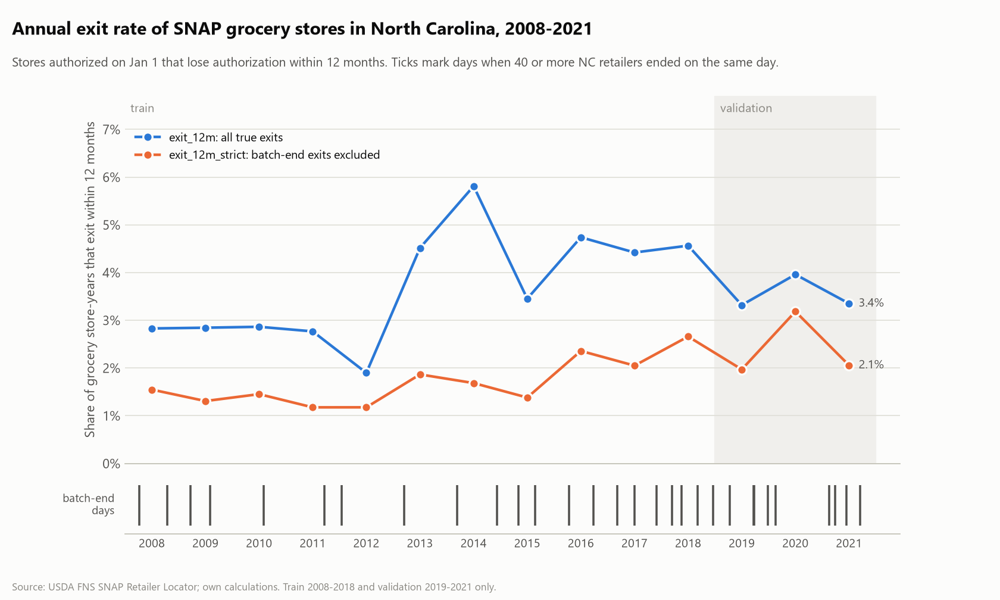
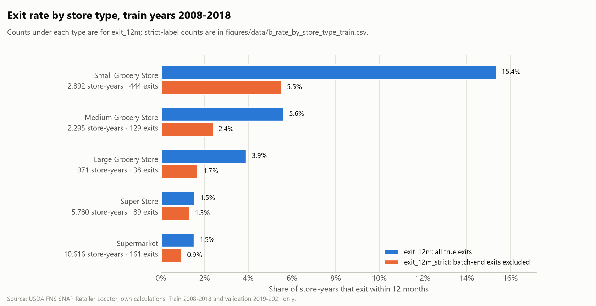
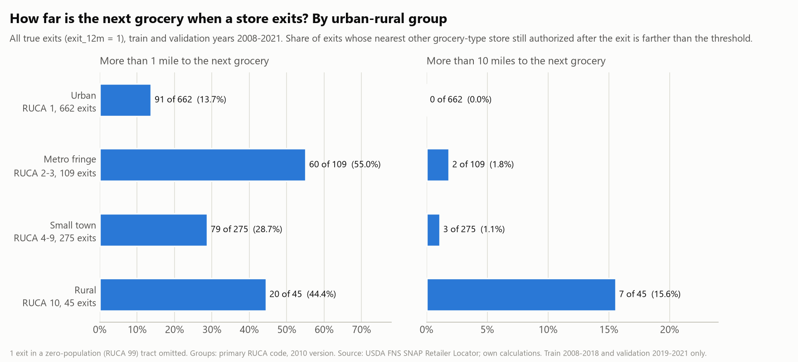

# Data Note: SNAP Grocery Exits in North Carolina

**D2: Data preparation and EDA**

- Dashboard: https://jrdn-sentosa--snap-grocery-exits-nc-run.us-east.modal.run/
- Repository (D2 snapshot, tag `d2`): https://github.com/jrdn-sentosa/snap-grocery-exits-nc/tree/d2

## Overview

This project looks at grocery stores in North Carolina that stopped accepting SNAP benefits. We studied when these exits happened, which communities were affected, and whether another SNAP grocery store remained nearby. Research question: using only information available on January 1 of each year, can we predict which SNAP-authorized grocery stores in North Carolina will lose SNAP authorization within the next 12 months more accurately than the historical exit rate for their store type?

## Data and preparation

The main source was the USDA Historical SNAP Retailer Locator, with 703,441 records nationally and 22,845 in North Carolina. We also used Census ACS data, geographic tract boundaries, and rural-urban classifications. The dashboard additionally uses grocery-proximity data. We cleaned placeholder dates, invalid coordinates, city names, and addresses, then combined authorization records into store histories. The data sources and cleaning steps are documented in the repository.

Each row in the USDA data is an authorization period, not a store, and a store's authorization sometimes lapses briefly before being renewed. We merged periods for the same store when the gap was 90 days or less, since a short lapse is usually paperwork and not a real exit. Every source file has a checksum so we can tell if anything changed, and all columns are explained in the data dictionary. We also kept track of race and ethnicity data, but only to check our model for bias later, not as a model input.

## How exits were defined

An exit means a store lost SNAP authorization within 12 months of January 1 of each year. We also created a stricter measure that excludes large groups of deauthorizations on the same date. We refined the rules to avoid treating ownership changes as true exits and documented five manual corrections. The final labels are saved as `labels-v3`.

The hardest part was telling real exits apart from ownership changes. When a store gets a new owner, the old record ends and a new one starts, which looks like an exit even though the store never closed. We changed our rule for this three times after finding real examples, like an Earth Fare that re-registered before its old record ended and a Compare Foods on N Tryon that showed up as two records at the same address. This brought the number of exits down from 1,161 to 1,071. We also checked whether the big same-day batches (a day when at least 40 stores lost SNAP at once) were just paperwork. 68% of batch-ended locations had no SNAP store again by the end of 2021, compared with 35% of other endings, so we kept them as real exits.

## Main findings

Across the study, 250 of 1,071 exits statewide (23.3%) had no other SNAP grocery store within one mile. In Mecklenburg County, this was 7 of 131 exits (5.3%). These gaps were more common in rural and metro-fringe areas. Large batches of deauthorizations were also important: 32 dates accounted for about 32% of recorded endings.

Tract poverty shows a 2.5× higher exit rate overall, but this disappears among small and medium groceries (0.94×). See [feature_associations.md](feature_associations.md).

So losing SNAP doesn't always mean losing access. Most exits still had another SNAP grocery nearby, but about one in four statewide didn't, mostly outside the city.

## Exploratory plots

More plots are in the [figures](../figures/) folder.

**a. Exit rate by year.** Exits spiked in 2013 and 2014, peaking at 5.8%, but most of that spike came from batch ends. Since the yearly ups and downs follow USDA clean-ups more than store behavior, we don't use year as a model input.

**b. Exit rate by store type.** Small grocery stores exit at about 15%, around ten times the rate of supermarkets. Store type alone already tells us a lot about which stores are at risk.

**c. Distance to the next grocery.** In cities, only 14% of exits left no grocery within a mile, compared with 29% in small towns, 48% in rural areas, and 55% in metro-fringe areas. The rural and fringe groups are small, so those numbers are rough.

## Dashboard check

The [interactive dashboard](https://jrdn-sentosa--snap-grocery-exits-nc-run.us-east.modal.run/) is a Streamlit app deployed on Modal that reads its data live from our Supabase database. It has five tabs: a map of active and exited grocery stores for any year; exit rates by year and store type; distance to the next grocery after each exit, by urban/rural group; SNAP coverage gaps, showing how long store locations went without SNAP authorization; and data quality, with the cleaning log and batch days. Filters let users choose the year, store type, area (statewide or Mecklenburg) and exit definition (all exits or excluding batch deauthorizations). Data runs through 2021, since 2022–2024 is reserved for testing.

To verify it, we compared the dashboard's Mecklenburg view for 2021 against our processed data: 233 grocery stores, 12 exits (5.2%), one of which left no other SNAP grocery within a mile. The totals matched.

## Data split and limitations

Training used 2008–2018, validation used 2019–2021, and 2022–2024 was reserved for testing. Exits were uncommon (about 3.75% in training and 3.54% in validation), so precision-recall measures are more informative than accuracy alone. The results have limitations: the distance is measured from the exited store, not residents; a nearby small grocery counts; and walking routes, transit, roads, and other barriers are not considered. Small subgroup counts also need care.

Our split is a little different from our proposal, which started training in 2011 instead of 2008. We split by year instead of randomly because the same store shows up in many years, and a random split would let the model see the future. The test years are kept off the dashboard and out of Supabase, which is why the dashboard stops at 2021. At one point, a single date from the test period was printed by accident while looking up one store, but it was never used for anything, and we logged it in the repository.

There are a few other concerns. The training and validation years don't look the same, since batch ends were a much bigger share of exits in training (55%) than in validation (33%), and stores that lost SNAP in 2019–2021 came back far more often than earlier ones. The data also only includes stores that were authorized at any point from 2005 to 2025, chain size is guessed from store names, and the new 2026 SNAP stocking rule happens after our data ends. Finally, 139 cases where a grocery store was sold and became a non-grocery store aren't counted as exits, so we may be slightly undercounting.

## Conclusion

Most SNAP grocery exits do not leave a nearby gap: 77% statewide and 95% in Mecklenburg had another SNAP grocery within a mile. The exits that matter most are concentrated in metro-fringe and rural areas: more than half of the metro-fringe exits and nearly half of rural exits left no SNAP grocery within a mile, and in rural areas about one in six left none within ten miles. This is why predicting which exits create gaps is more useful than predicting exits alone. Store type is one of the early signals of risk, with smaller groceries exiting at about ten times the rate of well-known supermarkets. Because smaller groceries are more common in lower-income areas, much of the apparent link between neighborhood poverty and exits reflects where small groceries are located, which our models in D3 must account for.

## Explanation of folders in repository

| Folder | Contents |
|---|---|
| `app` | The Streamlit dashboard (`streamlit_app.py`) and its Modal deployment (`modal_app.py`) |
| `data` | Raw, interim, and processed data (not committed; rebuilt by the scripts), `sources.yaml` (every source file with its download link and checksum, so everyone uses identical inputs) and `reference/` (release dates and successor overrides) |
| `docs` | Cleaning log, data dictionary, label-rule revisions, batch, gap and feature-association reports, plot interpretations, the proposal |
| `figures` | The EDA plots used in this note |
| `src` | `prep/` (pipeline scripts 00–06) and `eda/` (plots and reports) |
| `supabase` | The database schema |
