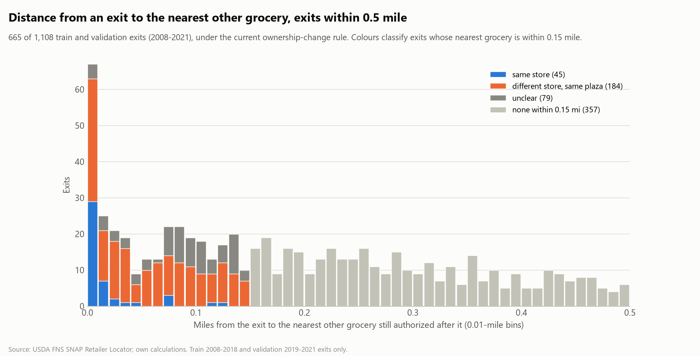

# Exit proximity review (report only)

Generated by `src/eda/exit_proximity.py`; do not edit by hand. Train and validation exits only (2008-2021); 1,071 exits under the current labels (ownership-change rule of `03_spells.py`, see `docs/label_rule_change.md`).

## 1. Distance to the nearest other grocery at exit, 0-0.5 mile

635 of 1,071 exits (59%) have a grocery within 0.5 mile; 288 (27%) within 0.15 mile. The first ten 0.01-mile bins hold 57, 24, 19, 18, 8, 13, 13, 21, 22, 19 exits; the average bin from 0.20 to 0.50 mile holds 9.2. The 0.00-0.01 bin alone holds 57 exits; by class: different store, same plaza: 34, same store: 19, unclear: 4.

## 2. Exits with another grocery within 0.15 mile

Neighbour = another grocery store still authorized on the exit date (the definition behind `impact_dist_nearest_other_grocery_mi`; recomputed here and checked equal to the panel). **Same store** = a neighbour with a similar name (cleaned-name similarity >= 0.8) or the identical standardized street address including the unit; **different store, same plaza** = no such neighbour, but one on the same street with a clearly different name (similarity < 0.6); **unclear** = the rest.

| class | exits |
|---|---|
| none within 0.15 mi | 783 |
| different store, same plaza | 182 |
| unclear | 78 |
| same store | 28 |

Fifteen examples, five per group (random, seeded):

| class | exit store | exit address | exit end | nearest grocery | its address | miles | name sim | same address+unit | its start vs exit end (days) |
|---|---|---|---|---|---|---|---|---|---|
| same store | PIGGLY WIGGLY 09 | 332 NE BLVD | 2017-05-21 | Charlie C's IGA 790 | 332 NE BLVD | 0.002 | 0.14 | True | -61.0 |
| same store | Piggly Wiggly 3 | 506 W GANNON AVE | 2015-08-24 | Charlie C's IGA 810 | 506 W GANNON AVE | 0.0 | 0.14 | True | -228.0 |
| same store | Healthy Home Market 5 | 1816 GALLERIA BLVD | 2018-09-03 | Kosher Mart and Delicatessen, Inc | 1816 GALLERIA BLVD | 0.014 | 0.32 | True | -2414.0 |
| same store | SAMMY'S SUPERMARKET | 1518 BOSTIC SUNSHINE HWY | 2017-11-29 | Drop-in Family Market 4 | 1518 BOSTIC SUNSHINE HWY | 0.011 | 0.29 | True | -146.0 |
| same store | FARM FRESH 469 | 683 S HUGHES BLVD | 2018-10-18 | Food Lion 2238 | 683 S HUGHES BLVD | 0.0 | 0.0 | True | -198.0 |
| different store, same plaza | BOULEVARD KWIK PIK | 1100 N MAIN ST | 2012-09-16 | Iga Food Liner | 1124 N MAIN ST | 0.121 | 0.22 | False | nan |
| different store, same plaza | Tienda Esperanza | 2808 RANDLEMAN RD | 2017-11-29 | Salymas African American Market | 2804 RANDLEMAN RD | 0.01 | 0.35 | False | -540.0 |
| different store, same plaza | EURO GROCERY STORE | 3759 N HWY 16 | 2009-09-10 | BARGAIN CENTER DISCOUNT GROCERY | 3825 N HWY 16 | 0.141 | 0.1 | False | -1109.0 |
| different store, same plaza | EL RANCHERO | 4523 N CHERRY ST | 2010-04-12 | La Perlita | 4534 CHERRY ST | 0.01 | 0.38 | False | -269.0 |
| different store, same plaza | Kroger 102 | 6840 MARKET ST | 2021-04-01 | FOOD LION 1406 | 6932 MARKET ST | 0.149 | 0.2 | False | -8553.0 |
| unclear | GOLDSBORO SAVE A LOT 28 | 211 N BERLKEY BLVD | 2017-05-29 | Kmart 7046 | 201 N BERKELEY BLVD | 0.025 | 0.16 | False | -5849.0 |
| unclear | FIRST ORIENT MARKET | 801 N 2ND ST | 2013-12-03 | HARRIS TEETER 078 | 817 N 1ST ST | 0.111 | 0.4 | False | -15569.0 |
| unclear | Zwekabin Asian Market | 1229 S MAIN ST SUITE 111 | 2017-03-22 | Sunrise Grocery Store | 1110 S MAIN ST | 0.068 | 0.1 | False | -1503.0 |
| unclear | EL EXITO | 1229 W CLEMMONSVILLE RD | 2009-01-25 | FOOD LION 348 | 3197 PETERS CREEK PKWY | 0.098 | 0.5 | False | -7888.0 |
| unclear | Frutas Y Verduras Aviles | 101 RAILROAD ST | 2020-11-23 | La Coseha | 103 CHURCH ST | 0.074 | 0.24 | False | -3576.0 |

The 'same store' class by how long before the exit the matching neighbour started (a neighbour that started long before cannot be a successor):

| neighbour started | identical address+unit only | similar name |
|---|---|---|
| 181-365 days before | 10 | 0 |
| more than 1 year before the exit | 7 | 2 |
| within 180 days before | 9 | 0 |

Earth Fare 120 (Record ID 740603) is **no longer an exit**: it is an ownership change to Record ID 1429066 (basis: name, name similarity 1.00, 0.059 mile away, authorized 252 days before the end).
