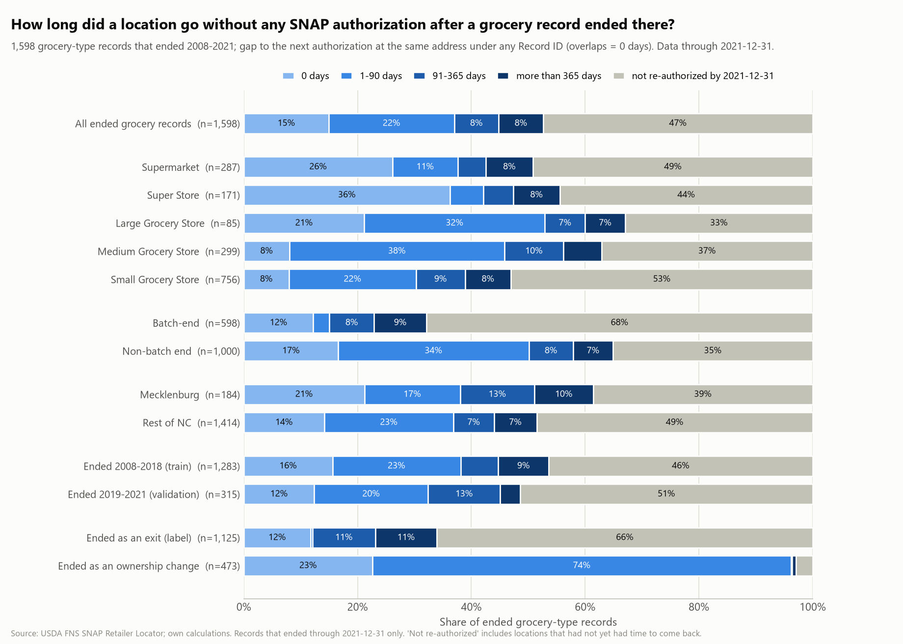

# Location-level SNAP coverage gaps (data through 2021-12-31)

Generated by `src/eda/location_gap_report.py` from `data/processed/location_gap.parquet` (`05b_location_gaps.py`); do not edit by hand. 1,598 grocery-type records that ended between 2008-01-01 and 2021-12-31. For each, the number of days its **location** (standardized street address + ZIP; coordinates only when there is no street number) had no SNAP authorization of any kind, until the next authorization started under any Record ID. An authorization still in force when the record ended, or starting that day, counts as 0 days. Nothing after 2021-12-31 is used: a location whose next authorization came later is in the last column.

## Distribution

| group | n | 0 days | 1-90 days | 91-365 days | more than 365 days | not re-authorized by 2021-12-31 |
|---|---|---|---|---|---|---|
| All ended grocery records | 1598 | 15.0% | 22.0% | 7.8% | 7.8% | 47.4% |
| Supermarket | 287 | 26.1% | 11.5% | 4.9% | 8.4% | 49.1% |
| Super Store | 171 | 36.3% | 5.8% | 5.3% | 8.2% | 44.4% |
| Large Grocery Store | 85 | 21.2% | 31.8% | 7.1% | 7.1% | 32.9% |
| Medium Grocery Store | 299 | 8.0% | 37.8% | 10.4% | 6.7% | 37.1% |
| Small Grocery Store | 756 | 7.9% | 22.4% | 8.6% | 8.1% | 53.0% |
| Batch-end | 598 | 12.2% | 2.8% | 7.9% | 9.2% | 67.9% |
| Non-batch end | 1000 | 16.6% | 33.5% | 7.8% | 7.0% | 35.1% |
| Mecklenburg | 184 | 21.2% | 16.8% | 13.0% | 10.3% | 38.6% |
| Rest of NC | 1414 | 14.1% | 22.7% | 7.1% | 7.5% | 48.5% |
| Ended 2008-2018 (train) | 1283 | 15.6% | 22.5% | 6.6% | 8.9% | 46.4% |
| Ended 2019-2021 (validation) | 315 | 12.4% | 20.0% | 12.7% | 3.5% | 51.4% |
| Ended as an exit (label) | 1125 | 11.7% | 0.4% | 11.0% | 10.8% | 66.0% |
| Ended as an ownership change | 473 | 22.6% | 73.6% | 0.2% | 0.6% | 3.0% |

Overall, 15% of ended grocery records left their location covered (0 days), 22% saw a new authorization within 90 days, 8% within a year, 8% after more than a year, and 47% had none by 2021-12-31.

Of the 1,125 ends labelled **exits**, 132 (12%) happened at an address that was still covered by another authorization (co-tenants, or a duplicate the ownership-change rule could not link); the ownership-change ends are the mirror image, mostly covered at once or re-authorized within 90 days.

## Equal follow-up

The last column above is censored: a record that ended in late 2021 had weeks to come back. Limiting to ends through 2018 gives every record at least three years.

| group | location re-authorized within 3 years |
|---|---|
| All, ended 2008-2018 | 50% (639 of 1283) |
| Exits | 29% (259 of 890) |
| Ownership changes | 97% (380 of 393) |
| Batch-end | 28% (144 of 514) |
| Non-batch end | 64% (495 of 769) |
| Mecklenburg | 58% (88 of 153) |
| Rest of NC | 49% (551 of 1130) |
| Supermarket | 48% (111 of 232) |
| Super Store | 64% (80 of 125) |
| Large Grocery Store | 62% (42 of 68) |
| Medium Grocery Store | 58% (134 of 233) |
| Small Grocery Store | 44% (272 of 625) |

## Reading it

- **0 days** means the address never lost SNAP: another store was already authorized there (a new owner, a co-tenant), so this end is not lost access at that address.
- **1-90 days** is a short hand-over, typically a new owner authorized soon after.
- **91-365 days and more than 365 days** are real gaps: the address went without SNAP for months or years before another authorization.
- **Not re-authorized** is the lasting loss as of the cut-off (or not yet re-authorized for recent ends; see the equal-follow-up table).
- The location is an address, not a building footprint: a plaza address with several tenants stays covered while one of them leaves.
