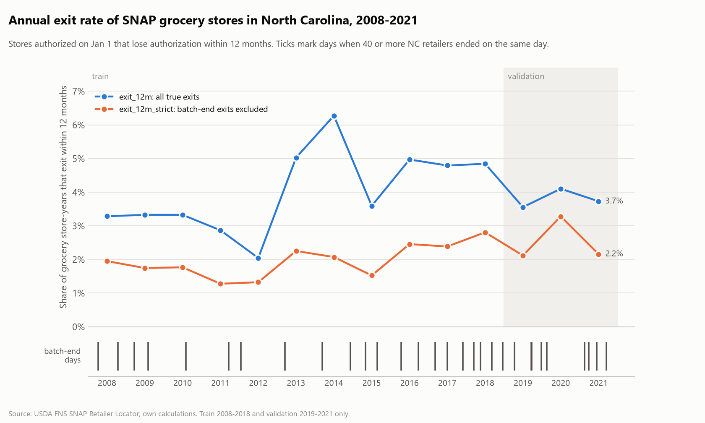
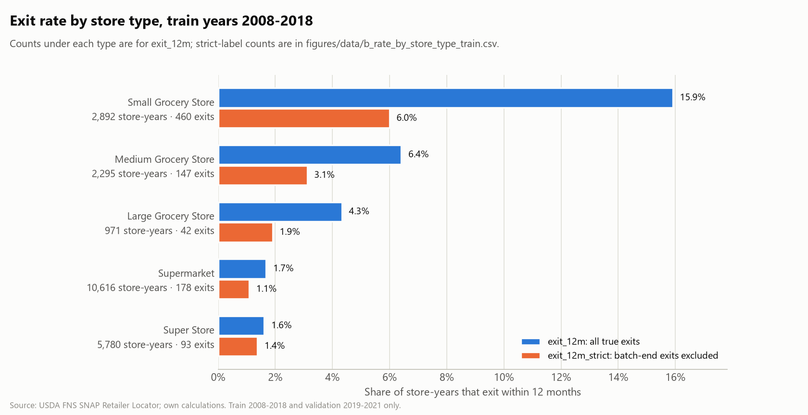
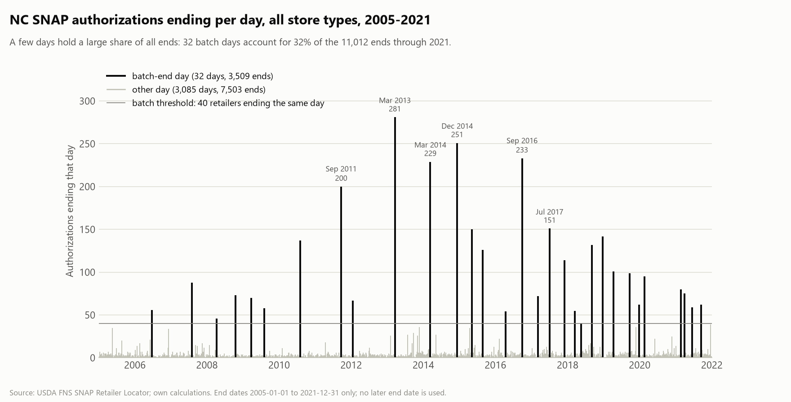
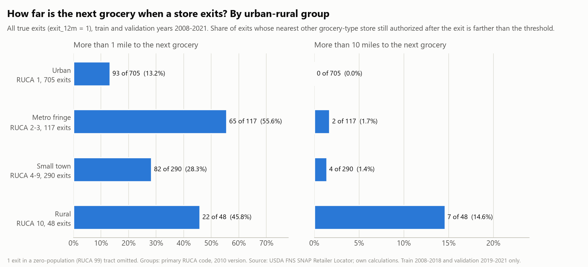
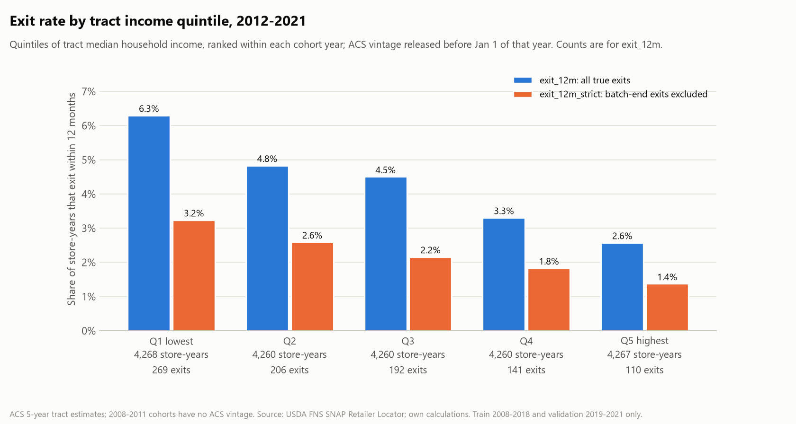

# Plot interpretations

Figures are made by `src/eda/plots.py` from **train and validation rows only** (cohort years 2008-2021; end dates through
2021-12-31). The numbers behind every chart are in `figures/data/*.csv`. `exit_12m` counts all true exits, batch ends included;
`exit_12m_strict` leaves batch-end exits out of the sample. The text below is written by hand from the figures as generated;
re-read it if the data or the code changes.

## (a) Annual exit rate, both labels, with batch days marked

The all-exits rate sits near 3.3% in 2008-2010, falls to 2.0% in 2012, then jumps to 5.0% in 2013 and peaks at 6.3% in 2014
(136 exits). Batch ends are 56% of exits in 2013 and 68% in 2014, which is why the strict rate is much flatter (1.3% in 2012,
2.1-2.3% in 2013-2014); the one year the two labels nearly meet is 2020, when only one batch day occurred and the strict rate
peaks at 3.3%. The year-to-year swings track USDA administrative clean-ups as much as store behaviour, which is why calendar year
is not allowed as a feature and why every result should be reported under both labels.

## (b) Train exit rate by store type

Small grocery stores exit far more often than any other type: 15.9% (460 exits in 2,892 store-years) against 1.7% for
supermarkets and 1.6% for super stores, a nine- to ten-fold gap. Batch ends hit small stores hardest: 305 of their 460 exits are
batch ends, so the strict rate drops to 6.0%, while super stores barely move (1.6% to 1.4%). Store type alone already separates
risk strongly, so the historical-rate-by-type baseline is a demanding benchmark, and supermarkets and super stores
(16,396 of the 22,554 train store-years) have too few exits per year for fine-grained comparisons.

## (c) Authorization end dates per day, with batch days

On a typical day 2 or 3 NC retailers lose authorization (3,085 ordinary days average 2.4 ends), but 32 days hold 40 to 281 ends
each: together 3,509 of the 11,012 ends through 2021 (32%), and the five largest days (Mar 2013, Dec 2014, Sep 2016, Mar 2014,
Sep 2011) alone are 11%. Batch days occur in every year from 2006 on, one or two a year through 2016 and three or four a year in 2017, 2018, 2019 and 2021. The 40-retailer threshold is
the 99th percentile of daily counts, a convention rather than a natural break, so a few days just above it (40-60 ends) may be
ordinary busy days; the strict label is the sensitivity check.

## (d) How far is the next grocery? By urban-rural group

When an urban store (RUCA 1) exits, another grocery is usually close: only 13% (93 of 705) leave a gap of more than a mile and
none leave more than 10 miles. The metro fringe (RUCA 2-3) has the highest share beyond a mile, 56% (65 of 117), above rural
areas (46%, 22 of 48), but rural exits are the only ones with a sizeable share beyond 10 miles (15%, 7 of 48, against 1.7% or
less elsewhere). The rural and metro-fringe groups are small (48 and 117 exits), so their percentages are imprecise; one exit in
a zero-population tract is omitted.

## (e) Exit rate by tract income quintile (2012 onward)

Exit rates fall steadily with tract income: 6.3% in the lowest quintile (269 exits in 4,268 store-years) down to 2.6% in the
highest (110 in 4,267), about 2.4 times higher at the bottom. The gradient survives dropping batch ends (3.2% down to 1.4%), so it
is not just an artefact of administrative clean-ups. Quintiles are ranked within each cohort year because dollars are adjusted to
different vintage years; this is an association only, and income may partly stand in for store type or size (not checked here:
whether small stores are concentrated in low-income tracts), which should be tested in D3 before reading it as a neighbourhood effect.
