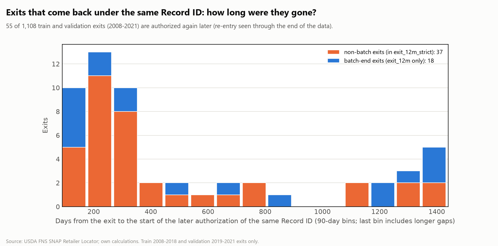

# Re-authorization gap analysis (report only; labels unchanged)

Generated by `src/eda/reentry_gap.py`; do not edit by hand. Train and validation exits only (2008-2021), under the current labels (1,108 exits, 554 of them non-batch). A re-entry is the same Record ID authorized again in a LATER spell, so the gap is always more than 90 days (shorter gaps are one spell). `qa_reentered_later` / `qa_reentry_gap_days` are QA columns, never features, because they use events after the exit.

## Headline

| exits | n | re-entered later | share | median gap (days) | 25th-75th pct (days) | median gap (years) |
|---|---|---|---|---|---|---|
| all exits, re-entry seen through the end of the data (Dec 2025) | 1108 | 55 | 5.0% | 310 | 201-759 | 0.8 |
|   batch-end exits (exit_12m only) | 554 | 18 | 3.2% | 398 | 177-1237 | 1.1 |
|   non-batch exits (exit_12m_strict) | 554 | 37 | 6.7% | 298 | 215-544 | 0.8 |
| all exits, re-entry started by 2021-12-31 only | 1108 | 45 | 4.1% | 274 | 191-681 | 0.8 |
|   non-batch exits, by 2021-12-31 only | 554 | 29 | 5.2% | 246 | 210-419 | 0.7 |

Re-entries observed only through 2021-12-31 undercount, because later exits and later years had less time to return; the first row also includes re-entries in 2022-2025.

## How long were they gone?

| gap | all exits | batch | non-batch |
|---|---|---|---|
| 91-180 days | 10 | 5 | 5 |
| 181-365 days | 23 | 4 | 19 |
| 1-2 years | 7 | 2 | 5 |
| more than 2 years | 15 | 7 | 8 |

## Where do they come back?

| re-entry location vs the exit | exits |
|---|---|
| same address and unit | 55 |

55 of 55 re-entries keep the same standardized store name.

## By exit year and store type

| year | exits | re_entered | share | share within 3 years |
|---|---|---|---|---|
| 2008 | 51 | 0 | 0.0% | 0.0% |
| 2009 | 54 | 3 | 5.6% | 3.7% |
| 2010 | 61 | 1 | 1.6% | 1.6% |
| 2011 | 56 | 1 | 1.8% | 0.0% |
| 2012 | 41 | 3 | 7.3% | 4.9% |
| 2013 | 99 | 2 | 2.0% | 1.0% |
| 2014 | 133 | 1 | 0.8% | 0.0% |
| 2015 | 74 | 2 | 2.7% | 1.4% |
| 2016 | 108 | 1 | 0.9% | 0.9% |
| 2017 | 98 | 3 | 3.1% | 2.0% |
| 2018 | 99 | 6 | 6.1% | 3.0% |
| 2019 | 70 | 6 | 8.6% | 7.1% |
| 2020 | 87 | 10 | 11.5% | 10.3% |
| 2021 | 77 | 16 | 20.8% | 20.8% |

**The share that returns rises sharply for recent exits, and not because of follow-up time.** Within 3 years of the exit, 1.5% (13 of 874) of the 2008-2018 (train) exits came back under the same Record ID, against 12.8% (30 of 234) of the 2019-2021 (validation) exits; the median gap of the re-entries fell from 784 to 239 days. Either USDA started keeping the Record ID when a lapsed store is re-authorized, or lapses and renewals became more common (for example around 2020-2021), so recent exits are more often temporary. The cause is not identified here.

| store_type | exits | re_entered | share |
|---|---|---|---|
| Small Grocery Store | 550 | 29 | 5.3% |
| Supermarket | 207 | 2 | 1.0% |
| Medium Grocery Store | 167 | 20 | 12.0% |
| Super Store | 136 | 1 | 0.7% |
| Large Grocery Store | 48 | 3 | 6.2% |

## What would a longer merge threshold do?

Today periods of one Record ID are merged into one spell when the gap is at most 90 days (`MERGE_GAP_DAYS` in `03_spells.py`). A longer threshold would make the exits below continuous authorization, but the store-years that fall inside such gaps would then count as active on Jan 1.

| merge same-Record-ID periods when the gap is <= (days) | exits that would disappear | share of exits | Jan-1 store-years added inside those gaps |
|---|---|---|---|
| 90 | 0 | 0.0% | 0 |
| 180 | 10 | 0.9% | 2 |
| 365 | 33 | 3.0% | 17 |
